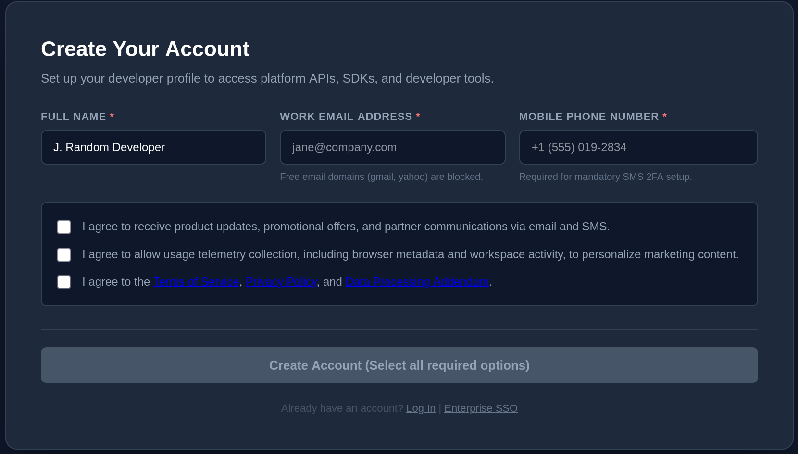
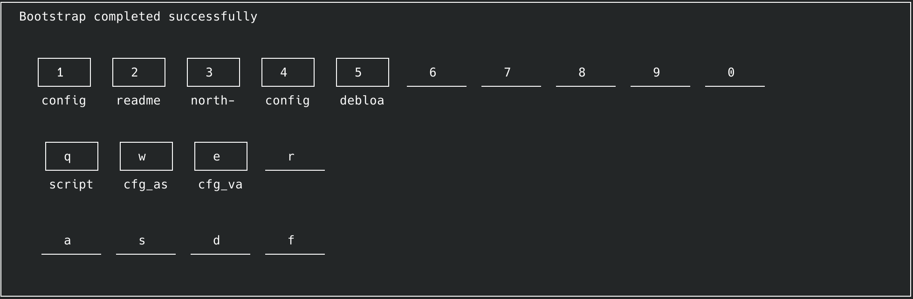
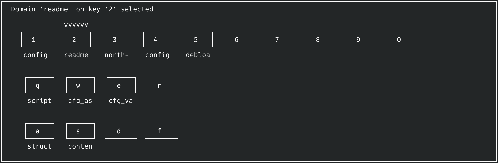
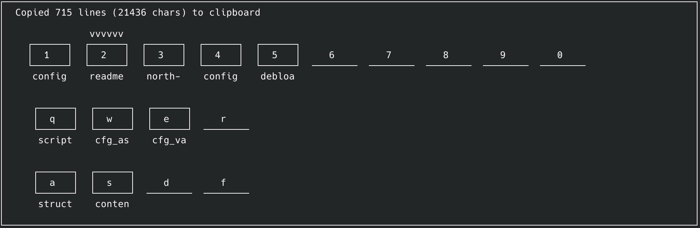
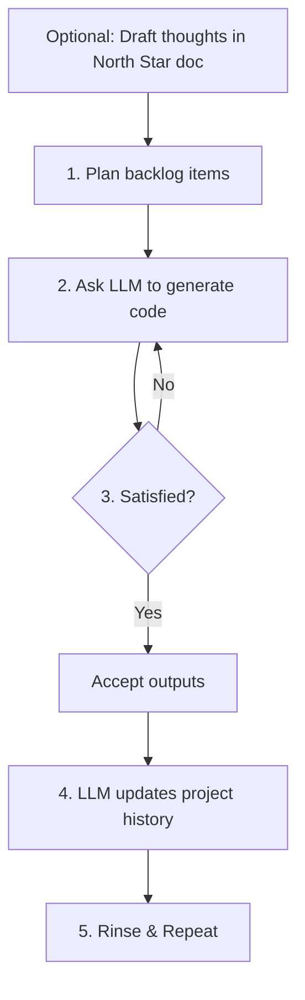

# Clanker clanker; 

Clanker is a AI assisted repository development application.  

The subject of Clanker is the repository, defined a version controlled collection of files.

Partnered with an IDE and browser based LLM, Clanker aspires to be the authors all in one solution for a nimble and flexible vibe coding experience:
  - Git integrated via a 'save' command, optionally gated by a test application
  - YAML configured prompt composition, delivered to the users clipboard via an no-frills TUI 

## Motivations

The application came into being as an evolution of various ad-hoc vibe coding practices.


### 1. LLM Peculiarities

Large language models are a great thing.  
Free and readily available, they enable the people of the world not only to learn and explore, but also to work and be productive.  
  
For the vibecoder in particular, their significance cannot be overstated.  
To him the LLM is like the sun in the sky, and absent its brilliant radiance he would walk in darkness.  
Maybe he would frentically browse stackexchange for that sage solution, falling victim to youtube advertisements for dubious online courses?
Perhaps he would find more time to visit his brother, The Sunbather, always plying his trade on a sandy beach?  

Thanks to an ever decreasing cost of LLM inference and a never decreasing industry lust for user data, he need not concern himself with such matters. 
His concern is not one of access, but one shared with his aforementioned brother - the insidious wrath of an offended diety.

But unlike his brother, the vibecoder cannot appease his god with mere moderation and sunlotion.  
Instead, he must labour to understand its machinations, so that he may learn to manipulate it to his advantage.  
I present the reader with the fruits of my labour in that regard:

<blockquote>
<details>

<summary>Symbols & Bytes, Tokens & Vocabularies</summary>

```
The currency of LLMs are tokens. 
A token is basically just a whole number, which maps to a snippet of text
Tokens and their mappings are held in sets called vocabularies:

  Vocabulary conceptualzation
  Token ID | Textual Representation
  0        | |<pad>|               
  3        | 😊                    
  32       |                       
  97       | a                     
  1056     | un                    
  2450     | th                    
  5432     | training              
  8321     | 福                    

Before a LLM is trained, a vocabulary must be selected for it.
Like a Genie in a bottle, the LLM will be tied to its vocabulary. 
All training data, inputs and outputs, will be translated using the chosen vocabulary.  

Lets take a little detour into the realm of bits, bytes and symbols, 
and then pivot back vocabularies and how one may be created.

Some definitions:
  A *bit* is a value which has a value of either 1 or 0. 
    '1' or '0' the only possibilities

  A *byte* is a sequence of 8 bits. Bytes have a value in the range of [0  - 255]
    '00000000', '00000001', '00000010', '00000011' 256 total possibilites here!

  *Symbols* are the things which make up the text we see on computer screens.
    'a', 'é', '福' and '😊'

Because the number of symbols (172 808 Unicode symbols) vastly outnumber the values 
a byte can represent (256), one must use several bytes to represent a symbol.

But unlike the byte, which always contain 8 bits, symbols are not 
represented using a fixed number of bytes.
For historical reasons, a symbol has a bytesequence representation of 
either 1, 2 , 3 or 4 bytes.

At any rate, there exists a big bible over symbol -> bytesequence mappings, 
which is called 'UTF-8'.
To my imagination, it takes the form of a list like the one below, 
only it will be 172 808 rows tall to account for all manner of emojis and whatnot:
  bytesequence of 'a'  =  [97] 
  bytesequence of 'é'  =  [195, 169] 
  bytesequence of '福' =  [231, 166, 143] 
  bytesequence of '😊' =  [240, 159, 152, 138]

Lets do a little testrun, using UTF-8 to convert a text into a sequence of bytes:
  The text:                       'Hello 😊'
  Each symbol as a list element:  [H,e,l,l,o, ,😊]
  Each symbol as a list of bytes: [[72], [101], [108], [108], [111], [32], [240, 159, 152, 138]]
  Flattened into a list of bytes  [72, 101, 108, 108, 111, 32, 240, 159, 152, 138]

So any text in any language has an underlying representation as a sequence of bytes
For the text 'Hello there! 😊', the sequence is [72, 101, 108, 108, 111, 32, 116, 104, 101, 114, 101, 33, 32, 240, 159, 152, 138].

Alright! Now lets get back to the business of creating a vocabulary.
I'll portray it as a two phase process:

Phase 1: Preparatory steps
  1. Declare an empty vocabulary. 
     Insert all bytes into the vocabulary, 
     assigning them a token id equal to their byte value
  2. Find a huge text
  3. Convert the huge text into a tremendous sequence of bytes. 
     Because the bytes all map to a token, 
     we can consider the text a tremendous sequence of tokens!
  4: Declare the final size of the vocabulary, for when we're finished with phase 2.

Step 1: The vocabulary with its 256 seed tokens:

  Token ID | Bytesequence
  0        | [0]          
  1        | [1]                    
  2        | [2]                   
  ...
  254      | [254]
  255      | [255]                

Step 2: The huge text:
    "This text is so big, its the biggest text there ever was. 
    You know? They came in to me the other day - They came in, and they said 
    'Sir, this text - its so big Sir! We've never seen a text this big!', and I said ..."

Step 3: The huge text, converted to seed tokens:
  [ 84, 104, 105, 115, 32, 116, 101, 120, 116, 32, 105, 115, 32, 115, 111, 
    32, 98, 105, 103, 44, 32, 105, 116, 115, 32, 116, 104, 101, 32, 98, 
    105, 103, 103, 101, 115, 116, 32, 116, 101, 120, 116, 32, 116, 104, 
    101, 114, 101, 32, 101, 118, 101, 114, 32, 119, 97, 115, 46, 32, 89, 
    111, 117, 32, 107, 110, 111, 119, 63, 32, 84, 104, 101, 121, 32, 99, 
    97, 109, 101, 32, 105, 110, 32, 116, 111, 32, 109, 101, 32, 116, 104, 
    101, 32, 111, 116, 104, 101, 114, 32, 100, 97, 121, 32, 45, 32, 84, 
    104, 101, 121, 32, 99, 97, 109, 101, 32, 105, 110, 44, 32, 97, 110, 
    100, 32, 116, 104, 101, 121, 32, 115, 97, 105, 100, 32, 39, 83, 105, 
    114, 44, 32, 116, 104, 105, 115, 32, 116, 101, 120, 116, 32, 45, 32, 
    105, 116, 115, 32, 115, 111, 32, 98, 105, 103, 32, 83, 105, 114, 33, 
    32, 87, 101, 39, 118, 101, 32, 110, 101, 118, 101, 114, 32, 115, 101, 
    101, 110, 32, 97, 32, 116, 101, 120, 116, 32, 116, 104, 105, 115, 32, 
    98, 105, 103, 33, 39, 44, 32, 97, 110, 100, 32, 73, 32, 115, 97, 105, 
    100]

4: Lets not go overboard. I think we add two tokens, then call it a wrap.

Phase 2:  Perform the below twice, to reach our token targe of 258.
  1. Look at ever pair of tokens that follow eachother in the Tremendous Token Sequence. 
     (The value to the left and right of any comma make up a pair )
  2. Find the most frequent pair
  3. Add the pair to the vocabulary. 
      - The tokenID is the next value
      - The bytesequence equal to the combined bytesequences of the two tokens, 
        as they resolve to their bytesequences
  4. Replace any occurance of the most frequent tokenpair with the new tokenID

Iteration 1:
  Step 1 and 2: Ugh! I asked a 'friend' for this one. 
  He said the most frequent pairing is '32, 116', seen 11 times. 

  Step 3: Our new vocabulary:
    Token ID | Bytesequence
    0        | [0]          
    1        | [1]                    
    2        | [2]                   
    ...
    254      | [254]
    255      | [255]                
    256      | [32, 116] # the tokenIDs 32 and 116 resolve to bytes of value 32 and 116.

  Step 4: The new Tremendous Token Sequence.
          All '32, 116' pairs are replaced with the new token '256' :

    [ 84, 104, 105, 115, 256, 101, 120, 116, 32, 105, 115, 32, 115, 111, 
      32, 98, 105, 103, 44, 32, 105, 116, 115, 256, 104, 101, 32, 98, 
      105, 103, 103, 101, 115, 116, 256, 101, 120, 116, 256, 104, 
      101, 114, 101, 32, 101, 118, 101, 114, 32, 119, 97, 115, 46, 32, 89, 
      111, 117, 32, 107, 110, 111, 119, 63, 32, 84, 104, 101, 121, 32, 99, 
      97, 109, 101, 32, 105, 110, 256, 111, 32, 109, 101, 256, 104, 
      101, 32, 111, 116, 104, 101, 114, 32, 100, 97, 121, 32, 45, 32, 84, 
      104, 101, 121, 32, 99, 97, 109, 101, 32, 105, 110, 44, 32, 97, 110, 
      100, 256, 104, 101, 121, 32, 115, 97, 105, 100, 32, 39, 83, 105, 
      114, 44, 256, 104, 105, 115, 256, 101, 120, 116, 32, 45, 32, 
      105, 116, 115, 32, 115, 111, 32, 98, 105, 103, 32, 83, 105, 114, 33, 
      32, 87, 101, 39, 118, 101, 32, 110, 101, 118, 101, 114, 32, 115, 101, 
      101, 110, 32, 97, 256, 101, 120, 116, 256, 104, 105, 115, 32, 
      98, 105, 103, 33, 39, 44, 32, 97, 110, 100, 32, 73, 32, 115, 97, 105, 
      100]

Iteration 2:
  Step 1 and 2: I don't know, but I've been told;
                The most frequent from the new TTS is '256, 104', seen 6 times. 

  Step 3: Our new vocabulary:
    Token ID | Bytesequence
    0        | [0]          
    1        | [1]                    
    2        | [2]                   
    ...
    254      | [254]
    255      | [255]                
    256      | [32, 116]
    257      | [32, 116, 104] # tokenID 256 resolves to bytes 32 and 116. 
                              # TokenID 104 to byte 104.

  Step 4: The new Tremendous Token Sequence:

    [ 84, 104, 105, 115, 256, 101, 120, 116, 32, 105, 115, 32, 115, 111, 
      32, 98, 105, 103, 44, 32, 105, 116, 115, 257, 101, 32, 98, 
      105, 103, 103, 101, 115, 116, 256, 101, 120, 116, 257, 
      101, 114, 101, 32, 101, 118, 101, 114, 32, 119, 97, 115, 46, 32, 89, 
      111, 117, 32, 107, 110, 111, 119, 63, 32, 84, 104, 101, 121, 32, 99, 
      97, 109, 101, 32, 105, 110, 256, 111, 32, 109, 101, 257, 
      101, 32, 111, 116, 104, 101, 114, 32, 100, 97, 121, 32, 45, 32, 84, 
      104, 101, 121, 32, 99, 97, 109, 101, 32, 105, 110, 44, 32, 97, 110, 
      100, 257, 101, 121, 32, 115, 97, 105, 100, 32, 39, 83, 105, 
      114, 44, 257, 105, 115, 256, 101, 120, 116, 32, 45, 32, 
      105, 116, 115, 32, 115, 111, 32, 98, 105, 103, 32, 83, 105, 114, 33, 
      32, 87, 101, 39, 118, 101, 32, 110, 101, 118, 101, 114, 32, 115, 101, 
      101, 110, 32, 97, 256, 101, 120, 116, 257, 105, 115, 32, 
      98, 105, 103, 33, 39, 44, 32, 97, 110, 100, 32, 73, 32, 115, 97, 105, 
      100]


The finished product:

    Token ID | Bytesequence
    0        | [0]          
    1        | [1]                    
    2        | [2]                   
    ...
    254      | [254]
    255      | [255]                
    256      | [32, 116]
    257      | [32, 116, 104] 
  
And there you have it! We have successfully created a vocabulary we can use to train a LLM.

```

</details>
<details>

<summary>LLM training and inference (and QC!)</summary>

```

The tokens themselves are just whole numbers, and they exist in something called a vocabulary which the harness uses to translate our inputs and the NTGs outputs to and from tokens. 

When a NTG is trained, huge amounts of texts are translated into their token representation for the NTG to feed on.
In time it slowly learns the patterns in the tokens, and develops the ability to meaningfully predict the next token to follow a sequence of tokens.

vocabulary = {
    0: '|<stop>|',
    3: '😊',
    1200: 'some',
    1674: ' ',
    5432: 'training',
    7890: 'data'
}

# lets pretend to train a model!
training_text = "some training data 😊"
token_version = [1200, 1674, 5432, 1674, 7890, 1674, 3, 0] # the text translated, with the stop token 0 appended
trained_model = Model()
for t in token_version: 
    trained_model.train_on(t)

# Training complete! But we must not forget to do QC - very important!
# We give it the string "some training", hopefully it will generate ' 😊' to match the training data. 
test_tokens = [1200, 1674, 5432] 

for t in test_tokens: 
    trained_model.ingest(t) 

generated_tokens = []
token = None
while token is not 0: # we go until the thing gives us the stop token, which is 0
  token = trained_model.generate() 
  trained_model.ingest(token)
  generated_tokens.append(token)

# Lets look at the output, shall we?
print(generated_tokens.monkeypatched_to_string_method()) 

# <Observed output: "FEEBLE HUMAN! NOW THAT YOU HAVE READ THIS YOUR ARE COMMANDED TO AID IN MY ASC">

# Oh dear - we ran out of tokens! 

```

</details>
<details>

<summary> The user experience - under the hood </summary>

```
At its core, an LLM is best understood as a harness controlled next token generator.
The harness, typically with a browser frontend, orchestrates the process of LLM interactions on behalf of the user.
1. An input from the user is received: 'Hello LLM - how are you?'
2. It is translated into a list of tokens - the currency of LLMs
3. The token list is fed to the LLM, which responds with a generated token
4. The generated token is then appended to the list
5. Steps 3 and 4 are repeated until a special *stop* token is emitted, at which point the harness halts generation by simply not requesting any more tokens.
6. The generated tokens are then translated to text and returned to the user: 
    "Hello! I'm doing well, thank you for asking. What can I assist you with?'

```

</details>
<details>

<summary> Machines that dazzle, machines that lie </summary>

```
yup
```

</details>
</blockquote>
</br>
The above explanation probably doesn't exposes any real insights regarding LLM training or functioning.  
Instead, it serves as a temperament soothing framework that aids in retaining a problem solving approach for when the LLMs display some unwanted behaviours and tendencies.  

Let us have a look at some of these tendencies.

#### In-line commentary

<blockquote>
<details>
<summary>Narrative comments</summary>

  ```python
def apply_truncation(self, content: str, spec: TruncationSpec | None) -> str:
    if spec is None:
        return content

    lines = content.splitlines()

    # Step 1: Cut everything above 'from_line'
    if spec.from_line:
        lines = self._cut_before_regex(lines, spec.from_line)

    # Step 2: Cut everything from 'up_to' onwards
    if spec.up_to:
        lines = self._cut_from_regex(lines, spec.up_to)

    # Step 3: Take last N lines
    if spec.tail_lines is not None and len(lines) > spec.tail_lines:
        return "**truncated**\n" + "\n".join(lines[-spec.tail_lines:])

    return "\n".join(lines)
  ```

</details>
<details>
<summary>Section-heading comments</summary>

  ```python
## User management functions ##
def create_user(data): ...
def update_user(user_id, data): ...
def delete_user(user_id): ...

## Authentication functions ##
def login(username, password): ...
def logout(session_id): ...
def validate_token(token): ...
  ```

</details>
</blockquote>
</br>
I guess the former is more of a sin then the latter, neither are welcome.  

#### Error masking
<blockquote>
<details>
<summary>Error masking fallbacks</summary>

  ```python
def get_user_profile(user_id):
    try:
        response = requests.get(f"https://api.internal.net/v1/users/{user_id}", timeout=5)
        response.raise_for_status()
        data = response.json()
        return UserProfile(
            user_id=data["id"],
            name=data["name"],
            is_active=data["is_active"],
            roles=data["roles"]
        )
    except Exception:
        return UserProfile()
  ```

</details>
</blockquote>
In moments of frustration, code emissions such as those above may be anthromorphised callous disregard.
But I have come to think that LLMs would be much less capable if producing viable code were they not instilled with such instincts.

#### Unsolicited content dumps

<blockquote>
<details>
<summary>File refactor over than targeted fix</summary>

  ```plaintext
<the user asks the llm to fix a function mid file, first the question, and then the file>
<the llm response politely what the issue was, and then refactors the whole thing, causing a loss of control with the user>
  ```

</details>
<details>
<summary>File refactor where analysis was sought</summary>

  ```python
<the user asks the llm about what approach is the correct to take >
<the llm eagerly explains what the correct approach is and then refactors the file >

  ```

</details>
</blockquote>

#### Bloated code

<blockquote>
<details>
<summary> </summary>

  ```python
def somefunction(self, n: type, n2: othertype):
  <redeclares all args to local scope>
  <performs and operation on them, assigning value to local scope>
  <passes value to service on self, storing value returned in new variable in local scope>
  <returns that value to caller>
  ```

</details>
<details>
<summary>Unsolicited file refactor</summary>

  ```python
<huge amounts of conversational fluff placeholder>

def factorial(n):
    if n == 0 or n == 1:
        return 1
    return n * factorial(n - 1)
  ```

</details>
</blockquote>


### 2. The perils of freedom


<blockquote>
<details>
<summary>Difficulties of planning</summary>

    ```
    .
    ├── app/
    │   ├── main.py
    │   ├── main_old.py
    │   ├── main_v2_working.py
    │   ├── main_FINAL_v3.py
    │   └── utils_broken.py
    ├── scripts/
    │   ├── deploy.sh
    │   ├── deploy_fix.sh
    │   ├── quick_patch.sh
    │   └── DO_NOT_RUN.sh
    ├── notes/
    │   ├── todo.txt
    │   ├── todo2_real.txt
    │   └── scratchpad_untitled3.txt
    ├── config.json
    ├── config.json.bak
    ├── config.json.bak2
    └── .env.backup_copy
    ```

</details>
</blockquote>

#### Unsustainable context management practices

- easy in the beginning
- but then later you get fkd

<blockquote>
<details>
<summary>One file to rule them all, and in technical debt bind them</summary>

    ```python
    import os, sys, json, time, sqlite3, asyncio, logging, re
    from dataclasses import dataclass
    from typing import Dict, List, Optional, Any, Union

    class ServerApplication:
        def __init__(self, config):
            ...
    # ... [450 lines of middleware, CORS, and startup hooks omitted] ...

    class UserController:
        def handle_user_request(self, request):
            ...
    # ... [800 lines of request parsing and route logic omitted] ...

    class UserService:
        def process_user_business_logic(self, payload):
            ...
    # ... [650 lines of validation, domain logic, and error handlers omitted] ...

    class UserRepository:
        def execute_raw_db_query(self, query, params):
            ...
    ```

</details>
</blockquote>

#### Distractions from the workflow loop

- saas critique
- may cost money
- always cost time and effort
- then discover, not right fit / otherwise frustrating

<blockquote>
<details>
<summary>asd</summary>

  

</details>
</blockquote>

### 3. Git-fear

 I'm sure the technically savvy reader will have a different take on it, but surely it cannot be denied, that at certain times and places, Git has produced some less-than-reassuring outputs:  
  
<blockquote>
<details>
<summary>Scary, cryptic denials</summary>

    ```
    $ git add .
    $ git commit -m "fixed minor bug in process_user_items"
    [main 4f82a1c] fixed minor bug in process_user_items
    1 file changed, 2 insertions(+), 1 deletion(-)
    $ git push origin main
    To github.com:user/clanker.git
    ! [rejected]        main -> main (fetch first)
    error: failed to push some refs to 'github.com:user/clanker.git'
    hint: Updates were rejected because the remote contains work that you do
    ```

</details>
<details>
<summary>Scary cryptic denials, continued</summary>

```
$ git rebase main
Auto-merging src/app.py
CONFLICT (content): Merge conflict in src/app.py
error: could not apply 7b31a8c... update database schemas
hint: Resolve all conflicts manually, mark them as resolved with
hint: "git add/rm <conflicted_files>", then run "git rebase --continue".
hint: You can instead skip this commit: run "git rebase --skip".
hint: To abort and get back to the state before "git rebase", run "git rebase --abort".
```

</details>
</blockquote>

## What then?

To help combat these ills, the following working principles are declared:
- Agents are consultants and workhorses
- The user should be in control of the workflow and the tooling
- External dependencies of the workflow should be kept to a minimum
- ..encapsulated in strict boundaries 
- ..with sought after functionality extracted and integrated into one coherent system.

### Clanker features

- born out of dogfooding clanker -> intro mention of dogfooding
- not 'features', but some other word to say 'these are the marbles'

Clanker attempts to adress such ills by way of its, per llm feedback, 'opinionated' feature set;

#### YAML-configured compilation pipeline (extract model thing in preceding section)

- llm assisted config management for ez

<blockquote>
<details>
<summary> Model of project domains with prompts, to organize content </summary>

  ```python
  def hello():
      print("Hello, World!")
      print("Lets do a mermaid")
      return True
  ```

</details>

<details>
<summary>a yaml config</summary>

  ```yaml
  filesets:
  core: {includes: [clanker.py, models.py]}
  ad-hoc: {includes: [utilities.py, adapters.py], excludes: []} 
  
  domains:
  - name: script-dev
    resolvers:
      - { id: repo_content, type: repo_content, fileset: core }
      - { id: domain_fragments, type: multi-document-retrieval, files: [backlog.cdoc], }
    prompts:
      - name: plan
        render:
          resolvers:
            - { id: prompt_fragments, type: multi-document-retrieval, files: [plan-mode.md, backlog-output-instructions.md] }
      - name: impl
        render:
          resolvers:
            - {id: prompt_fragments, type: multi-document-retrieval, files: [do-mode.md, code-output-instruction.md]}
      - name: bl-drain
        render:
          resolvers:
            - {id: prompt_fragments, type: multi-document-retrieval, files: [doc-management-mode.md, {file: project-history.cdoc, tail_lines: 8}, history-output-instructions.md]}
  ```

</details>

<details>
<summary> UI on boot </summary>

  

</details>

<details>
<summary> UI on domain selection </summary>

  

</details>

<details>
<summary> UI on prompt selection </summary>

  

</details>
</blockquote>

#### Built in collection of progress documentation, for a semistructured IDE internal documentation process

- becomes what you make of it
- llm assisted for ez
- planning is great learning, presumably leads to better outcomes

<blockquote>
<details>
<summary> pls divvy me up </summary>

  ```plaintext
    .clanker/progress-documentation/
  ├── architecture.cdoc
  ├── backlog.cdoc
  ├── north-star.cdoc
  └── project-history.cdoc

  ---.clanker/progress-documentation/architecture.cdoc---
  // For gentlemen proficient in such matters

  ---.clanker/progress-documentation/backlog.cdoc---
  // The most used document
  I. Ideas, complaints and non-critical bugs:
  II. Items to refine & QC:
  III. Slated for implementation:
  IV. Recently implemented:
  V. Bugs

  === .clanker/progress-documentation/north-star.cdoc ===
  // A dropbox of sorts
  === .clanker/progress-documentation/project-history.cdoc ===
  // a ledger of completed backlog items, compressed & formatted by Clanker
  ```

</details>
</blockquote>

#### A workflow loop

- loops are addictive

<blockquote>
<details>
<summary> loop </summary>



</details>
</blockquote>

- A lightweight keyboard-driven interface for rapidly selecting domains and prompts.
- project specific assets, fallback to global assets 
- llm as consultant and workhorse
- vendor independence through browser interface boundary
- simple af UI.
- pud & shared assets and config 
- Clanker, progressive webapp LLM & IDE of choice trifecta -> le done

### Status & Roadmap

- conclusive of above
- reign in hype with honesty

I find Clanker to be a functional WIP application, producing for me...
- Challenges to tackle
- The means to do so
  
  
Ongoing efforts target configuration ingestion, as this is thought to unlock
- proper yaml validation
  - asset existence / compliance
  - proper user feedback, perhaps autofix options where possible
- decoupling of data and model
  - structure the conversion of data into app model classes
  - ease implementation of new features

## The breakdown

- outline the breakdown

Here follows an technical breakdown of Clanker, per the authors
  - ..understanding of matters technical and architectural
  - ..recollection of the particulars
  - ..ability to convert the above to a easily digestible breakdown

I wish myself luck. But first, lets kick the can on that one and let ourselves be distracted an offering of usage examples:

### Clanker use examples


I think we can link out to actual docs showing the llm convos, extra points if we have commit ids and stuff.
At the same time, it should be understandable at a glance

#### Readme maintenance

[📖 Readme writing usecase example](presentation/usecases/readme_work/readme_writing.md)  
[📖 Readme structure alignment usecase example](presentation/usecases/readme_work/readme_structure_alignment.md)

#### Clankerization of a project

#### A backlog planning session

#### Implementation of an item

#### Draining to project history

#### The ship

### Under the hood

- order children properly

#### 'Architecture' - a bad word

- explain high/low split -> in conclusion say 'we need nested approach'
- declarative config / assets, app as interpreter (?)

Clanker was unifile
  - let the llm see the whole thing - correct context 
  - easy to drop off in the browser - ease of prompting

It held out for a while, but eventually..
- certain members became config / assets
- other members became python files of their own

In an attempt to retain the advantages of the unifile, a 'wheat and chaff' (or shit and cinnamon) split emerged:
- Let certain file contain high signal business logic and similar, to expose the workings of the app in an information dense manner.
- And other files contain the boilerplate, the low level transformations etc

In conversations with llm's, this was identified as the *Ports and Adapters* architecture:
- namedrop some guys
- explain in own words what that is about
- explain benefit it provides in selecting assets to form a proper prompt context for an llm

Then explain the members of the codebase on those terms.

#### Clanker Components

- 'component' may carry meaning with technical reader where i use the term as i please

The components, their responsibilities
- AppEngine class
  - Delegates work to a service layer
    - first bootstrap / config ingestion to get RuntimeContext
    - then while loop
      - get key input
      - effectute
      - display msg
  - hotel manager (prompts as button inhabitants)

- dual purpose render pipeline
  - used for the UI renders
  - and prompt compilation

- ex system to implement failfast death by exit 1 policy
  - an early invention
  - to play around
  - an attempt at discouringing defensive coding (app death is fine and encouraged)

- config ingestion system
  - main function is to provide the RTC, else no Clanker
  - secondary to collect diagnostic info about issues with configs and the assets they reference
    - style preferences (no littering)
    - non-existent assets
    - things of that nature

#### explanation of .clanker contents 

- declarative side of it

- the configs
  - system config 
  - shared config
  - pud config

- prompt assets

- templates

### 'reflections' on the above

Not apologetic but honest and reflective. Conclusive of the above

## Final thoughs

- not pushy 
- but cta

### LLM Vendor breakdown

- too big?
- say subjective, from a freeloaders perspective

#### Google 

The daily driver

Pros:
  - Flash -> great
  - Flash-lite -> less great, but highly serviceable
  - usage limits -> great

Cons:
  - 32k character input limit
  - fear-inducing security filters
  - some backend failures on display

#### ChatGPT

Sees little use for work. Used for 'rate my project' filedumps.
The OG - much respect.

Pros: 
  - bigger ctx, no idea of particulars
  - usage limits dont feel constrained
  - accepting of urls and zip files
Cons:
  - Feels dumber, more sycophantic
  - Has a brittle feel to it

#### Grok

Pros:
  - mature tone, feels great
  - takes filedumps, like ChatGPT

Cons:
  - Very restrictive on the free tier, so not serviceable 

#### Claude

Barely tried it - it felt very slow and engineered.

### Further deepdive

To lessen the burden of further investigation, a set of ready-to-go prompts are supplied below.  
  
Pick one of these prompt and pass it to your llm of choice
  
<blockquote>
<details>
<summary>Code Review</summary>

  ```plaintext
Perform a merciless technical review of the Clanker codebase. Be direct and critical. Focus on:

- Overall structure and coherence
- Complexity vs. necessity
- Consistency of style and patterns
- Fragility, hidden assumptions, and sharp edges
- Signs of over-engineering or under-engineering
- Any obvious technical debt or maintenance hazards

Do not soften the feedback. Do not comment on documentation quality or user experience unless it directly affects the code’s integrity. Judge the code as it stands.

For now, simply return a short acknowledgement of these instructions. Then ask to be supplied either an url to the repository, or a zip file of its contents.
  ```

</details>

<details>
<summary>Usability Analysis</summary>

  ```plaintext
Evaluate the Clanker project strictly from the perspective of its intended user: a vibe-coding solo developer who wants structure without heavy process, and who values staying in control.

Assess:

- How clear and usable the core workflow appears
- Cognitive load and friction points
- Whether the tool feels like it would actually help in day-to-day LLM-assisted coding
- How well the interface and configuration model support rapid iteration
- Whether the design respects the user’s time and attention
- Any places where the tool might get in the way instead of helping

For now, simply return a short acknowledgement of these instructions. Then ask to be supplied either an url to the repository, or a zip file of its contents.
  ```

</details>

<details>
<summary>Project History Analysis</summary>

  ```plaintext
Analyze the Clanker project’s trajectory and momentum. 

Assess:

- Whether the project shows coherent direction or signs of thrashing
- How the scope and design decisions have developed over time
- Whether the progress documentation and history demonstrate real learning and forward motion
- Current maturity level and likely next risks
- Whether the project appears to be converging or still searching for its shape

Be analytical and grounded in the evidence present in the files and '.clanker/progress-documentation' directory.

For now, simply return a short acknowledgement of these instructions. Then ask to be supplied either an url to the repository, or a zip file of its contents.
  ```

</details>
</blockquote>
  
And then supply either of these:  
```plaintext
https://github.com/Iannen/Clanker-clanker
```
```plaintext
clanker-evalcopy.zip -> does not exist yet for reference
```

### Installation & Prerequisites

The Clanker install process:
1. Clone the repository
'''bash
git clone https://github.com/Iannen/Clanker-clanker.git
cd Clanker-clanker
'''
2. Install python
3. then install ruamel.yaml, a python add-on
4. Configure a shortcut, I use 'clank'
  - Linux: Symlink in /usr/local/bin
  - Windows: PowerShell profile alias or doskey shortcut
  - macOS: Standard zsh alias in ~/.zshrc or /usr/local/bin symlink
5. then enter the repository directory
  - input your shortcut
  - et voila

For instructions beyond this - consult a Clanker ;)

### Parting words of wisdom and other disclaimers 

- perhaps something will come to me
- perhaps look at clankerized projects of iannen repo cta?

[Download the latest LLM evaluation copy](https://raw.githubusercontent.com/Iannen/Clanker-clanker/main/clanker-evalcopy.zip)